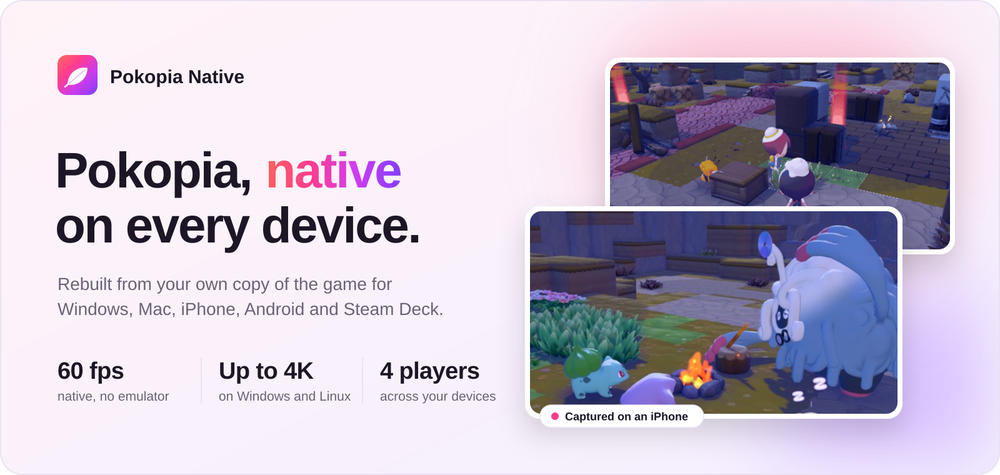
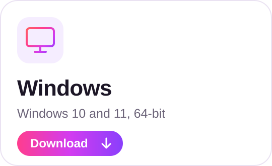
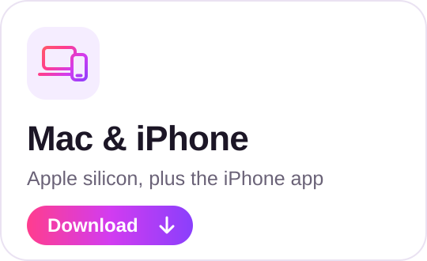
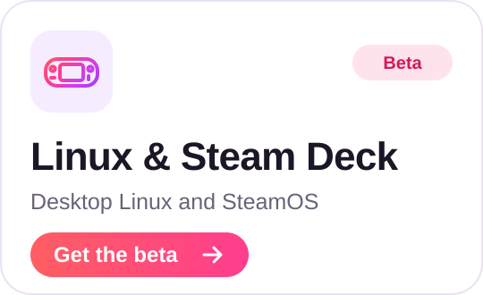
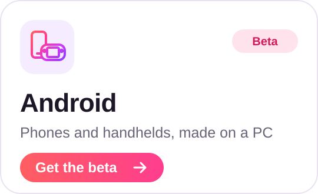
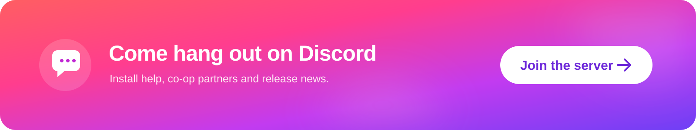
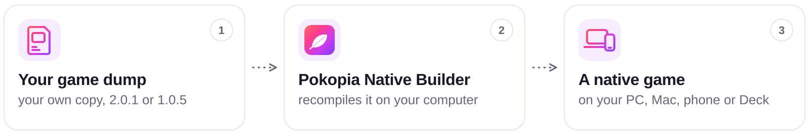
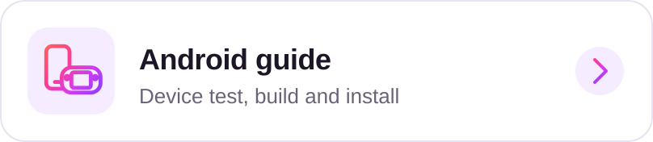

<picture>
  <source media="(max-width: 600px) and (prefers-color-scheme: dark)" srcset="docs/assets/hero-phone-dark.svg">
  <source media="(max-width: 600px)" srcset="docs/assets/hero-phone-light.svg">
  <source media="(prefers-color-scheme: dark)" srcset="docs/assets/hero-dark.svg">
  
</picture>

**Pokopia Native** takes your own dump of Pokémon Pokopia and rebuilds it to run natively on your computer, phone or handheld. The game's
code is recompiled for your processor and its graphics are translated to Vulkan or Metal, so there's no emulator in between. Your save goes
with you from device to device, and you can play together across them.

  <a href="https://github.com/xFractals/pokopia-native/releases/latest/download/Pokopia-Native-for-Windows.zip"><picture><source media="(prefers-color-scheme: dark)" srcset="docs/assets/get-windows-dark.svg"></picture></a>
  <a href="https://github.com/xFractals/pokopia-native/releases/latest/download/Pokopia-Native-for-Mac.zip"><picture><source media="(prefers-color-scheme: dark)" srcset="docs/assets/get-mac-dark.svg"></picture></a>
   
  <a href="https://github.com/xFractals/pokopia-native/releases?q=linux-beta"><picture><source media="(prefers-color-scheme: dark)" srcset="docs/assets/get-linux-dark.svg"></picture></a>
  <a href="https://github.com/xFractals/pokopia-native/releases?q=android-beta"><picture><source media="(prefers-color-scheme: dark)" srcset="docs/assets/get-android-dark.svg"></picture></a>

**New here?** Every download has a step-by-step guide: **[Windows](docs/WINDOWS.md)** · **[Mac](docs/MAC.md)** ·
**[iPhone](docs/IPHONE.md)** · **[Android](https://github.com/xFractals/pokopia-native/blob/android-beta/docs/ANDROID.md)** ·
**[Linux & Steam Deck](https://github.com/xFractals/pokopia-native/blob/linux-beta/docs/LINUX.md)**. Either the Windows or the Mac download also
builds the iPhone app. On Android, check your phone first with the device test on the
[Android beta's page](https://github.com/xFractals/pokopia-native/releases?q=android-beta). What's new is in the
[release notes](https://github.com/xFractals/pokopia-native/releases).

<a href="https://discord.gg/Aj9GqxZj8V"><picture><source media="(max-width: 600px)" srcset="docs/assets/discord-phone.svg"></picture></a>

> [!IMPORTANT]
> **Bring your own game.** Pokopia Native contains nothing of the game: no game files, no keys, no dumping tools. Everything is built on
> your computer from your own dump. Please never share build folders, apps, saves or shader files. Not affiliated with Nintendo,
> The Pokémon Company, GAME FREAK or Koei Tecmo ([LEGAL.md](LEGAL.md)).

> [!WARNING]
> **Pokopia Native is free, and always will be.** It will never charge you for anything: not the downloads, the builds, an app, a
> feature, early access, support or help. If anyone asks you to pay for Pokopia Native or for anything made with it, they have nothing to
> do with this project: don't pay them, and don't trust their files. The only official downloads are on this page and its
> [releases](https://github.com/xFractals/pokopia-native/releases).

## Get started

<picture>
  <source media="(max-width: 600px) and (prefers-color-scheme: dark)" srcset="docs/assets/flow-phone-dark.svg">
  <source media="(max-width: 600px)" srcset="docs/assets/flow-phone-light.svg">
  <source media="(prefers-color-scheme: dark)" srcset="docs/assets/flow-dark.svg">
  
</picture>

1. **Download** the zip for your computer (the buttons above) and unzip it into a new folder.
2. **Open Pokopia Native Builder.** It checks your computer, asks for your game files and builds. The first build takes 15 to 40 minutes
   (30 to 60 for Android); updates take 10 to 20.
3. **Play.** On Windows, open **Play Pokopia** in the build's `out` folder. On a Mac, open the app the builder made. For an iPhone or an
   Android phone, the builder makes the app and helps you put it on the phone: see the [iPhone guide](docs/IPHONE.md) or the
   [Android guide](https://github.com/xFractals/pokopia-native/blob/android-beta/docs/ANDROID.md).

**Want every step explained?** Open the guide for your device:

  <a href="https://github.com/xFractals/pokopia-native/blob/main/docs/WINDOWS.md"><picture><source media="(prefers-color-scheme: dark)" srcset="docs/assets/guide-windows-dark.svg"></picture></a>
  <a href="https://github.com/xFractals/pokopia-native/blob/main/docs/MAC.md"><picture><source media="(prefers-color-scheme: dark)" srcset="docs/assets/guide-mac-dark.svg"></picture></a>
   
  <a href="https://github.com/xFractals/pokopia-native/blob/main/docs/IPHONE.md"><picture><source media="(prefers-color-scheme: dark)" srcset="docs/assets/guide-iphone-dark.svg"></picture></a>
  <a href="https://github.com/xFractals/pokopia-native/blob/android-beta/docs/ANDROID.md"><picture><source media="(prefers-color-scheme: dark)" srcset="docs/assets/guide-android-dark.svg"></picture></a>
   
  <a href="https://github.com/xFractals/pokopia-native/blob/linux-beta/docs/LINUX.md"><picture><source media="(prefers-color-scheme: dark)" srcset="docs/assets/guide-linux-dark.svg"></picture></a>
  <a href="https://github.com/xFractals/pokopia-native/blob/main/docs/PLAYING-TOGETHER.md"><picture><source media="(prefers-color-scheme: dark)" srcset="docs/assets/guide-together-dark.svg"></picture></a>

<b>What your computer needs</b>

 

- **Windows 10 or 11, 64-bit:** a processor with AVX2, a graphics card with Vulkan 1.3, Python 3.12 to 3.14, the .NET 10 runtime and Git,
  and about 12 GB free per game version. No compiler, no administrator rights. [Windows guide](docs/WINDOWS.md)
- **Mac:** Apple silicon, Xcode with its Metal toolchain, Python 3.12 or newer and the .NET 10 runtime. 16 GB of memory is comfortable;
  8 GB struggles. [Mac guide](docs/MAC.md)
- **iPhone:** built by the Windows or Mac download and signed with your Apple account. [iPhone guide](docs/IPHONE.md)
- **Android (beta):** made on a Windows 10 or 11 PC with about 25 GB free, and put on the phone with a USB cable. The phone needs Android 11
  or newer, Snapdragon 8 Gen 1 or newer graphics, 8 GB of memory and about 9 GB free; the device test checks it in a few seconds.
  [Android guide](https://github.com/xFractals/pokopia-native/blob/android-beta/docs/ANDROID.md)
- **Linux and the Steam Deck (beta):** x86-64 with AVX2 and a Vulkan 1.3 driver (SteamOS has one), about 15 GB free.
  [Linux guide](https://github.com/xFractals/pokopia-native/blob/linux-beta/docs/LINUX.md)

The builder checks all of this for you and tells you what to install.

## What works where

|  | Windows | Mac | iPhone | Android | Linux &amp; Steam Deck |
|:--|:--:|:--:|:--:|:--:|:--:|
| **Release** | Stable | Stable | Stable | Beta | Beta |
| **Graphics** | Vulkan, 4K | Metal, MetalFX | Metal | Vulkan | Vulkan, 4K |
| **In-game settings** | F1 | Soon | Soon | Back | F1 |
| **Rebind keys** | ✓ | Soon | — | — | ✓ |
| **Rebind controller** | ✓ | Soon | Soon | Next beta | Next beta |
| **Controllers** | ✓ | ✓ | ✓ | ✓ | ✓ |
| **Touch controls** | — | — | ✓ | ✓ | — |
| **Link Play** | ✓ | ✓ | ✓ | Not yet | ✓ |
| **Story co-op** | ✓ | ✓ | ✓ | Not yet | ✓ |
| **Auto port forwarding** | ✓ | By hand | By hand | — | Next beta |
| **Import a save** | ✓ | By hand | By hand | Not yet | ✓ |

Link Play is for up to four players; Story co-op is experimental. Saves move between a PC, a Mac and an iPhone ([how](docs/SAVES.md)).

**On the way:** smoother edges (anti-aliasing), and settings on the Mac and iPhone.

## Play together

Link Play connects Pokopia Native on Windows, Mac, iPhone and Linux in any mix, up to four players, without Nintendo's servers. (The
Android beta doesn't have it yet.)

- **On the same Wi-Fi,** hosts find each other (Linux joins by address for now).
- **Over the internet or a VPN,** the host shares an address and a room code. On Windows, **F1 → Link Play → Copy invite** puts both in
  one line, and the game asks your router to open the port.
- **Story co-op** (experimental) lets visitors talk to the story characters and help the host's town along.

In the game: the PC in your house → **Link Play** → **Local connection**. More in the [Playing together guide](docs/PLAYING-TOGETHER.md).

## Help

- **Setting it up?** The step-by-step guides: [Windows](docs/WINDOWS.md) · [Mac](docs/MAC.md) · [iPhone](docs/IPHONE.md) ·
  [Android](https://github.com/xFractals/pokopia-native/blob/android-beta/docs/ANDROID.md) ·
  [Linux & Steam Deck](https://github.com/xFractals/pokopia-native/blob/linux-beta/docs/LINUX.md).
- **Something not working?** [Common problems](docs/TROUBLESHOOTING.md) has the usual fixes.
- **Moving your save?** [Your saves](docs/SAVES.md) covers the PC, the Mac and the iPhone.
- **Questions?** Ask on [Discord](https://discord.gg/Aj9GqxZj8V): install help, co-op partners and release news.
- **Found a bug?** [Open an issue](https://github.com/xFractals/pokopia-native/issues/new/choose). The forms say which log to attach, never
  your save or game files.
- **Curious how it works?** [How it works](docs/HOW-IT-WORKS.md) covers the recompiler, the shaders, and why it isn't an emulator.

## Credits and licence

**MIT licence** for Pokopia Native's own code. It also carries third-party components under their own licences, all listed in
[LEGAL.md](LEGAL.md).

- **NxNative**, the host the Mac and iPhone apps run on.
- **@Quantumenis**, for the Windows CPU work and the RTX 50 freeze fix.
- **@Shabbypenguin**, for the builder's copyable install command.
- **Testers on the Discord**, who find what we can't.
- Third-party libraries are listed with their licences in `windows/bin/THIRD-PARTY-NOTICES.txt`.

Pokémon and Pokopia are trademarks of Nintendo, Creatures Inc. and GAME FREAK inc. This project is not affiliated with or endorsed by
them. Rights holders: see [LEGAL.md](LEGAL.md).
